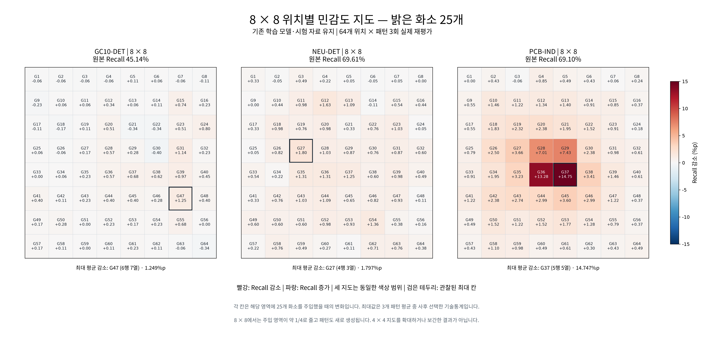
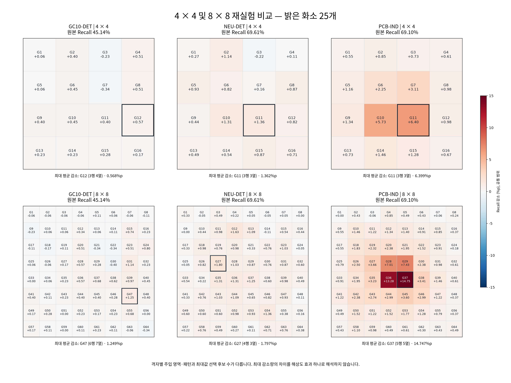

# 밝은 화소 25개 — 8×8 위치별 민감도 재실험

기존 GC10-DET, NEU-DET, PCB-IND의 학습된 YOLOv8n, 시험 데이터, confidence·IoU·전처리와 패턴 반복 수(3)를 유지하고 8×8 격자로 다시 추론했다. 재학습하거나 기존 4×4 지도를 보간하지 않았다.

## 조건과 실행

RGB 255 고립 화소 25개를 각 격자 안에 주입했다. 64개 위치 × 패턴 3회 = 손상 조건 192개, 원본 포함 데이터셋별 193개 추론 묶음이다. 사용한 시험 영상은 GC10 354장, NEU 270장, PCB 469장으로 총 210,949회 이미지 평가를 실행했다.

`configs/bright25_grid8.yaml`과 `protocol.json`에 설정, 기존 데이터·모델 해시, 실행 코드 해시를 기록했다. 원본 평가의 TP/FP/FN은 이전 4×4 실험과 같음을 확인했다. 민감도는 원본 Recall − 손상 Recall이며 양수는 성능 감소, 음수는 증가다.

## 8×8 결과

| 데이터셋 | 원본 Recall | 8×8 평균 감소 | 8×8 최대 감소 | 최대 위치 | 최대 위치 95% pointwise CI |
|---|---:|---:|---:|---|---|
| GC10-DET | 45.145% | 0.207%p | 1.249%p | G47 (6행 7열) | [0.207, 2.328]%p |
| NEU-DET | 69.608% | 0.622%p | 1.797%p | G27 (4행 3열) | [0.587, 3.132]%p |
| PCB-IND | 69.104% | 1.850%p | 14.747%p | G37 (5행 5열) | [8.891, 23.325]%p |

칸 번호는 왼쪽 위 G1부터 오른쪽 아래 G64까지 행 우선이다. 좌표는 영상 내 상대 위치이며 실제 센서의 절대 위치를 뜻하지 않는다.

## 4×4와 비교

| 데이터셋 | 4×4 평균 감소 | 8×8 평균 감소 | 4×4 최대 감소 | 8×8 최대 감소 |
|---|---:|---:|---:|---:|
| GC10-DET | 0.259%p | 0.207%p | 0.568%p | 1.249%p |
| NEU-DET | 0.664%p | 0.622%p | 1.362%p | 1.797%p |
| PCB-IND | 1.801%p | 1.850%p | 6.399%p | 14.747%p |

**두 격자는 주입 영역과 패턴이 다르다.** 같은 25개를 넣지만 8×8 한 칸의 면적은 4×4의 약 1/4이므로 손상이 더 좁은 영역에 모인다. 패턴 생성 시 격자 크기가 난수 seed에 포함되어 있어 새 패턴을 사용한다. 전체 영상 대비 명령 화소 수는 동일하지만 격자 내부 손상 밀도와 정답 상자와의 겹침은 달라질 수 있다. 64칸 중 최대값과 16칸 중 최대값은 선택 후보 수도 다르므로 최대값 변화만으로 위치 효과가 더 강해졌다고 확정하지 않는다.

## 통계와 범위

신뢰구간은 이미지 그룹과 패턴을 재표집한 2,000회 pointwise 쌍체 bootstrap이다. 지도 전체의 동시 구간, 다중 비교 보정, 학습 시드 불확실성 또는 위치 간 차이의 정식 검정이 아니다. 단일 학습 시드와 기존 분할에 조건부인 결과다.

PCB의 공식 분할에는 같은 숫자 ID의 t/b 면이 학습·시험에 걸칠 수 있어 독립 보드 일반화를 주장하지 않는다. NEU도 실제 제품/코일 ID가 확인되지 않았다. 원본 해상도와 resize 배율이 데이터셋마다 다르므로 같은 25개를 동일한 모델 입력 손상 면적으로 해석하지 않는다. 실제 RAW/ISP/DPC나 센서 수명은 평가하지 않았다.

## 파일

- [8×8 위치별 수치 CSV](grid8_cells.csv)
- [4×4·8×8 요약 CSV](summary_grid4_grid8.csv)
- [8×8 지도 PDF](bright25_grid8_recall_map_ko.pdf)
