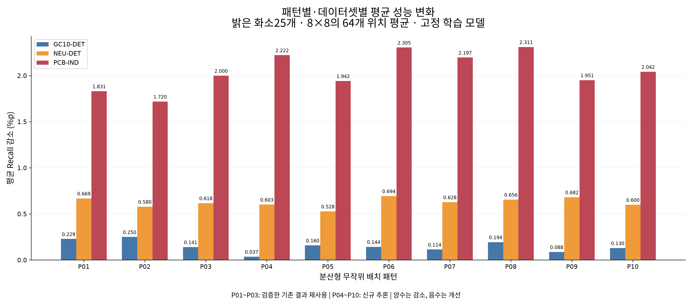
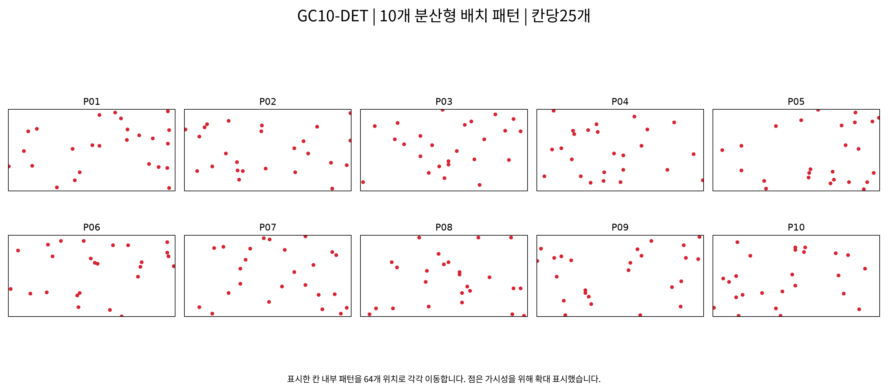
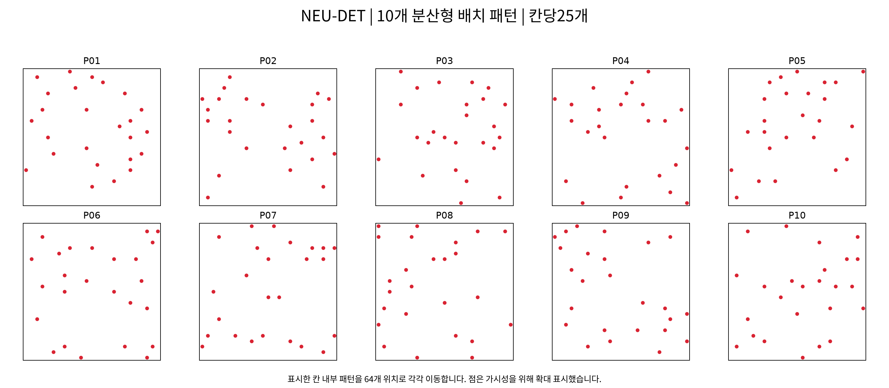
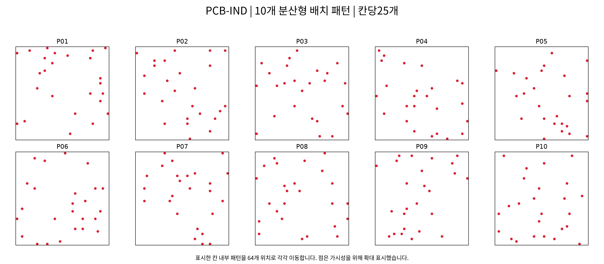

# 핫픽셀 10개 배치 패턴 — 데이터셋별 평균 결과

## 실험 정의

기존 학습된 YOLOv8n과 시험자료를 그대로 사용하고, RGB=255 고립 화소25개를 8×8 격자 안에 주입했다. **서로 다른 분산형 무작위 배치10개**를 비교한 실험이다. 군집·선형 등 서로 다른 손상 형태10종을 비교한 것은 아니다. 같은 패턴 안에서는 배치를 유지하고 64개 위치로 옮긴다. P번호는 각 데이터셋 내 패턴 번호이며, 데이터셋·해상도가 난수 seed에 포함되므로 같은 P번호라도 데이터셋 간 배치 형상이 같다는 뜻은 아니다.

패턴 P01~P03은 직전 8×8 실험의 결과다. 입력·모델·소스·환경·모든 주입/평가 설정이 동일한지 확인하고 예측 SHA256과 출처를 기록해 재사용했다. P04~P10은 새로 추론했다. 난수 seed와 정확한 칸 내부 좌표는 [patterns.json](patterns.json)에 저장했다. 패턴은 성능을 보고 선택하지 않았다.

설정: 화소25개, alpha=1, 모든 RGB채널255, grid8×8, seed base301, 패턴 인덱스0~9. imgsz640, conf operating0.25, matching IoU0.5, prediction floor0.001, NMS IoU0.7, max_det300, 같은 공식 COCO evaluator(maxDets100). 재학습하지 않았다.

## 평균 계산

- **패턴별 평균:** 해당 데이터셋·패턴의 64개 위치별 평가값을 동일 가중치로 평균.
- **데이터셋 총평균:** 패턴10개 평균을 동일 가중치로 평균. 즉64×10=640개 손상 평가값의 평균과 같다.
- 각 위치의 Recall은 그 데이터셋 시험자료 전체의 TP/GT로 계산한다. 이미지별 Recall을 먼저 평균하지 않는다.
- AP는 위치·패턴별 전체 시험자료를 공식 COCO evaluator로 평가한 뒤 평균한다. 서로 다른 패턴의 예측을 한 영상에 합치지 않는다.
- 감소량은 원본 − 주입 후이며 양수는 악화, 음수는 개선이다.

## 원본 기준 성능

| 데이터셋 | 시험 영상 / GT | 원본 Recall | 원본 Precision | 원본 mAP50 | 원본 mAP50:95 |
|---|---:|---:|---:|---:|---:|
| GC10-DET | 354 / 587 | 45.145% | 65.271% | 49.137% | 23.717% |
| NEU-DET | 270 / 612 | 69.608% | 65.639% | 69.267% | 36.359% |
| PCB-IND | 469 / 547 | 69.104% | 59.716% | 56.951% | 36.864% |

## 패턴별 평균 Recall (%)

| 패턴 | GC10-DET | NEU-DET | PCB-IND |
|---|---:|---:|---:|
| P01 | 44.916 | 68.939 | 67.273 |
| P02 | 44.895 | 69.028 | 67.385 |
| P03 | 45.004 | 68.990 | 67.105 |
| P04 | 45.108 | 69.005 | 66.882 |
| P05 | 44.985 | 69.079 | 67.162 |
| P06 | 45.001 | 68.913 | 66.799 |
| P07 | 45.030 | 68.980 | 66.908 |
| P08 | 44.950 | 68.952 | 66.793 |
| P09 | 45.057 | 68.926 | 67.153 |
| P10 | 45.014 | 69.008 | 67.062 |
| **10개 전체 평균** | **44.996** | **68.982** | **67.052** |

## 패턴별 평균 Recall 감소 (%p)

| 패턴 | GC10-DET | NEU-DET | PCB-IND |
|---|---:|---:|---:|
| P01 | 0.229 | 0.669 | 1.831 |
| P02 | 0.250 | 0.580 | 1.720 |
| P03 | 0.141 | 0.618 | 2.000 |
| P04 | 0.037 | 0.603 | 2.222 |
| P05 | 0.160 | 0.528 | 1.942 |
| P06 | 0.144 | 0.694 | 2.305 |
| P07 | 0.114 | 0.628 | 2.197 |
| P08 | 0.194 | 0.656 | 2.311 |
| P09 | 0.088 | 0.682 | 1.951 |
| P10 | 0.130 | 0.600 | 2.042 |
| **10개 전체 평균** | **0.149** | **0.626** | **2.052** |

## 패턴별 평균 mAP50 (%)

| 패턴 | GC10-DET | NEU-DET | PCB-IND |
|---|---:|---:|---:|
| P01 | 48.843 | 68.455 | 54.574 |
| P02 | 48.708 | 68.516 | 53.544 |
| P03 | 48.892 | 68.460 | 54.136 |
| P04 | 49.117 | 68.481 | 52.781 |
| P05 | 48.955 | 68.426 | 53.718 |
| P06 | 49.011 | 68.447 | 52.607 |
| P07 | 48.917 | 68.450 | 52.516 |
| P08 | 48.989 | 68.407 | 53.788 |
| P09 | 49.091 | 68.423 | 55.018 |
| P10 | 48.994 | 68.507 | 53.811 |
| **10개 전체 평균** | **48.952** | **68.457** | **53.649** |

## 패턴별 평균 Precision (%)

| 패턴 | GC10-DET | NEU-DET | PCB-IND |
|---|---:|---:|---:|
| P01 | 65.662 | 65.803 | 54.912 |
| P02 | 65.373 | 65.830 | 52.862 |
| P03 | 65.632 | 65.703 | 53.853 |
| P04 | 65.412 | 65.791 | 50.883 |
| P05 | 65.668 | 65.730 | 53.668 |
| P06 | 65.664 | 65.788 | 50.676 |
| P07 | 65.710 | 65.875 | 49.812 |
| P08 | 65.623 | 65.760 | 52.541 |
| P09 | 65.582 | 65.627 | 56.632 |
| P10 | 65.597 | 65.819 | 53.383 |
| **10개 전체 평균** | **65.592** | **65.773** | **52.922** |

## 패턴별 평균 mAP50:95 (%)

| 패턴 | GC10-DET | NEU-DET | PCB-IND |
|---|---:|---:|---:|
| P01 | 23.527 | 35.912 | 35.326 |
| P02 | 23.503 | 35.961 | 34.749 |
| P03 | 23.546 | 35.978 | 35.071 |
| P04 | 23.690 | 35.965 | 34.204 |
| P05 | 23.594 | 35.897 | 34.855 |
| P06 | 23.614 | 35.957 | 34.105 |
| P07 | 23.556 | 35.910 | 34.062 |
| P08 | 23.607 | 35.884 | 34.857 |
| P09 | 23.640 | 35.891 | 35.607 |
| P10 | 23.630 | 35.951 | 34.911 |
| **10개 전체 평균** | **23.591** | **35.931** | **34.775** |

## 데이터셋별 총평균

| 데이터셋 | 주입 후 평균 Recall | 평균 Recall 감소 | 주입 후 평균 Precision | 주입 후 평균 mAP50 | 주입 후 평균 mAP50:95 |
|---|---:|---:|---:|---:|---:|
| GC10-DET | 44.996% | 0.149%p | 65.592% | 48.952% | 23.591% |
| NEU-DET | 68.982% | 0.626%p | 65.773% | 68.457% | 35.931% |
| PCB-IND | 67.052% | 2.052%p | 52.922% | 53.649% | 34.775% |

## 배치 패턴에 따른 변동

| 데이터셋 | 패턴별 평균 감소 최솟값 | 최댓값 | 패턴 간 표준편차 |
|---|---:|---:|---:|
| GC10-DET | 0.037%p | 0.250%p | 0.064%p |
| NEU-DET | 0.528%p | 0.694%p | 0.051%p |
| PCB-IND | 1.720%p | 2.311%p | 0.202%p |

표준편차는 패턴별 64위치 평균10개의 표본 표준편차이며 학습 시드 불확실성 또는 신뢰구간을 뜻하지 않는다. 모든 위치와 모든 패턴을 포함했고 음수 변화도 유지했다.

## 입력 패턴 시각화

## 실행 증거

데이터셋마다 clean1+64×10=641개 완료 예측 묶음이다. 총700,613회분의 이미지 평가 결과를 사용했다. 그중210,949회분은 검증한 기존 예측이고489,664회는 신규 추론이다. 새 결과 폴더의 완료 표식에 기존 run hash·원본 파일·SHA256을 명시했다.

분석은 데이터셋마다 위치별 요약64행, 위치/패턴별 지표640행, 전체 합계699,520행의 쌍체 이미지 기록을 생성한다. 각 위치의 평균지도와2,000회 pointwise bootstrap 구간은 `runs/evaluation/{dataset}_s11_bright25_g8_p10/analysis/`에 저장했다. 해당 구간은 지도 전체 다중 비교 보정이나 패턴 평균 간 유의성 검정이 아니다.

## 해석 범위

모든 결과는 동일한 학습 시드의 고정 모델에 조건부다. 원본 해상도(GC10 2048×1000, NEU200×200, PCB300×300)와 resize 배율이 달라 동일25개가 동일 손상 비율 또는 입력 면적을 뜻하지 않는다. PCB는 중앙 ROI 분포와 공식 분할 내 숫자 ID의 양면 중복 가능성이 있으며, NEU도 실제 제품/코일 그룹이 확인되지 않았다. 실제 RAW/ISP/DPC 또는 출하 불량률은 검증하지 않았다.

## 수치 파일

- [패턴별·데이터셋별 모든 평균 지표](per_pattern_dataset_means.csv)
- [데이터셋별 총평균](dataset_overall_means.csv)
- [패턴별 Recall 표](recall_by_pattern.csv)
- [패턴별 감소량 표](recall_drop_by_pattern.csv)
- [패턴별 mAP50 표](map50_by_pattern.csv)
- [패턴별 Precision 표](precision_by_pattern.csv)
- [패턴별 mAP50:95 표](map50_95_by_pattern.csv)
