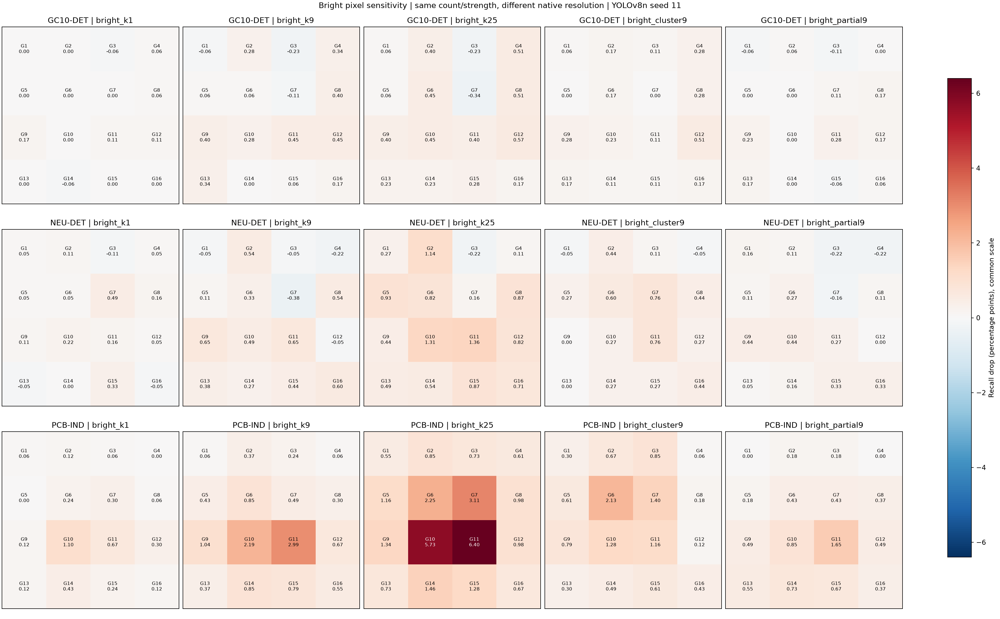

# 밝은 화소 위치 민감도: GC10-DET / NEU-DET / PCB-IND

사용자 요청에 따라 GC10에서 사용한 밝은 화소 조건을 나머지 두 데이터셋에 적용했다. 각 데이터셋은 동일한 원본 COCO 사전학습 YOLOv8n에서 독립 학습했다. GC10의 기존 결과는 변경하지 않고 동일한 밝은 조건만 추출했다.

## 공통 조건

학습 seed=11, imgsz=640, AdamW lr=0.001, batch=16, 최대 100 epoch, patience=20, 검증 best.pt 고정. 화소 손상 없이 학습하고 공간/색상 증강은 0이다.

원본 해상도에 RGB=255인 고립 화소 1/9/25개, 밝은 3×3 군집, alpha=0.5 부분 밝은 화소 9개를 주입했다. 4×4 grid, 3개 고정 패턴 반복, conf=0.25, matching IoU=0.5, 동일 COCO AP evaluator를 사용했다. 개수·값·배치 규칙은 동일하며 각 데이터셋/해상도에 맞춰 생성한 패턴을 위치만 이동한다.

## 원본 시험 성능

| 데이터셋 | 시험 영상 / GT | Recall | Precision | mAP50 | mAP50:95 |
|---|---:|---:|---:|---:|---:|
| GC10-DET | 354 / 587 | 45.14% | 65.27% | 49.14% | 23.72% |
| NEU-DET | 270 / 612 | 69.61% | 65.64% | 69.27% | 36.36% |
| PCB-IND | 469 / 547 | 69.10% | 59.72% | 56.95% | 36.86% |

## 밝은 화소 조건별 결과

평균은 16개 위치와 3개 패턴 반복에 대한 평균이며, 최대 위치 값은 3개 패턴의 평균 중 최대다. 양수는 감소, 음수는 개선이다. 최대 위치는 사후 기술통계이며 16칸 동시 검정으로 확정한 취약 위치가 아니다.

| 데이터셋 | 조건 | 평균 Recall 감소 (%p) | 최대 위치 평균 감소 (%p) | 최대 위치 | 해당 위치 pointwise 95% CI (%p) |
|---|---|---:|---:|---|---|
| GC10-DET | bright_k1 | 0.0248 | 0.1704 | G9 | [0.0000, 0.8033] |
| GC10-DET | bright_k9 | 0.1810 | 0.4543 | G11 | [0.0000, 1.2039] |
| GC10-DET | bright_k25 | 0.2591 | 0.5679 | G12 | [0.0000, 1.5425] |
| GC10-DET | bright_cluster9 | 0.1739 | 0.5111 | G12 | [0.0000, 1.4051] |
| GC10-DET | bright_partial9 | 0.0639 | 0.2839 | G11 | [-0.1727, 0.8376] |
| NEU-DET | bright_k1 | 0.1021 | 0.4902 | G7 | [-0.2258, 1.2864] |
| NEU-DET | bright_k9 | 0.2655 | 0.6536 | G9 | [0.1595, 1.3334] |
| NEU-DET | bright_k25 | 0.6638 | 1.3617 | G11 | [0.0545, 2.6846] |
| NEU-DET | bright_cluster9 | 0.2996 | 0.7625 | G7 | [-0.3705, 1.9115] |
| NEU-DET | bright_partial9 | 0.1362 | 0.4357 | G9 | [0.0000, 1.0023] |
| PCB-IND | bright_k1 | 0.2476 | 1.0969 | G10 | [0.4386, 1.9380] |
| PCB-IND | bright_k9 | 0.7655 | 2.9860 | G11 | [1.4351, 5.4729] |
| PCB-IND | bright_k25 | 1.8015 | 6.3985 | G11 | [3.8066, 10.4514] |
| PCB-IND | bright_cluster9 | 0.7122 | 2.1328 | G6 | [0.3465, 4.7751] |
| PCB-IND | bright_partial9 | 0.4723 | 1.6453 | G11 | [0.4006, 3.5089] |

## 해상도와 손상 비율

| 데이터셋 | 시험 영상 너비 범위 | 높이 범위 | 25화소의 평균 원본 면적 비율 | YOLO resize 배율 중앙값 |
|---|---:|---:|---:|---:|
| GC10-DET | 2048~2048 | 1000~1000 | 0.001221% | 0.312 |
| NEU-DET | 200~200 | 200~200 | 0.062500% | 3.200 |
| PCB-IND | 300~300 | 300~300 | 0.027778% | 2.133 |

같은 25개라도 NEU-DET 200×200과 PCB-IND 300×300에서는 GC10보다 원본 면적 대비 손상 비율이 높으며 YOLO 입력으로 확대된다. GC10의 큰 원본 영상은 축소되어 단일 화소 효과가 약해질 수 있다. 이 실험은 동일 화소 수에 대한 비교이며 손상 비율 또는 모델 입력상의 손상 면적을 일치시킨 비교는 아니다. 데이터셋 간 차이를 제조 대상이나 센서 민감도 차이 하나로 설명할 수 없다.

## 데이터 및 해석 범위

PCB-IND는 공식 Zenodo v4와 원래 분할을 사용했고, 정밀한 COCO 주석에서 라벨을 변환했다. 미확인 빈 라벨 127장은 제외했다. NEU-DET는 원 배포처의 1,800장을 점검하여 서로 같은 픽셀인데 주석이 다른 2장을 제외하고, 중복 상자 3개를 정리했다. VOC 1-based inclusive 좌표를 변환하고 difficult 객체도 정답으로 포함했다. 데이터셋별 상세 audit에 모든 처리 내역을 기록했다.

PCB-IND는 면 접두어(t/b 포함) 그룹, NEU-DET는 이미지 ID를 bootstrap 그룹으로 사용했다. PCB 숫자 접두어 683개 중 124개는 여러 분할에 걸치며, 학습–시험 겹침이 63개다. 같은 숫자 ID가 실제 보드의 양면을 뜻한다면 보드 단위 독립성이 없으므로 공식 분할 기준의 조건부 결과로 해석한다. 면별 bootstrap은 보드 양면 간 상관을 완전히 반영하지 못할 수 있다. 실제 제품/코일의 독립성은 확인되지 않았다. 특히 데이터셋마다 주석 정책과 시험 난이도가 다르므로 원본 성능도 함께 보아야 한다.

신뢰구간은 이미지 그룹 및 패턴 반복을 재표집한 2,000회 pointwise 쌍체 bootstrap이다. 위치 간 차이에 대한 정식 검정, 지도 전체 다중 비교 보정, 학습 시드 불확실성을 포함하지 않는다. 단일 학습 시드의 비교이므로 재현성을 확정하려면 복수 시드가 필요하다. 실제 센서 RAW/ISP/DPC 또는 제품 출하 불량률은 평가하지 않았다.

## 파일

- [GC10-DET 상세 결과](../../runs/evaluation/gc10_s11_frozen/analysis/REPORT_KO.md)
- [NEU-DET 상세 결과](../../runs/evaluation/neu_det_s11_bright/analysis/REPORT_KO.md)
- [PCB-IND 상세 결과](../../runs/evaluation/pcb_ind_s11_bright/analysis/REPORT_KO.md)

- [조건별 수치 CSV](bright_comparison.csv)
- [기준 성능·해상도·손상 비율 CSV](baselines_and_dose.csv)
- [실행 방법](../../README.md)
