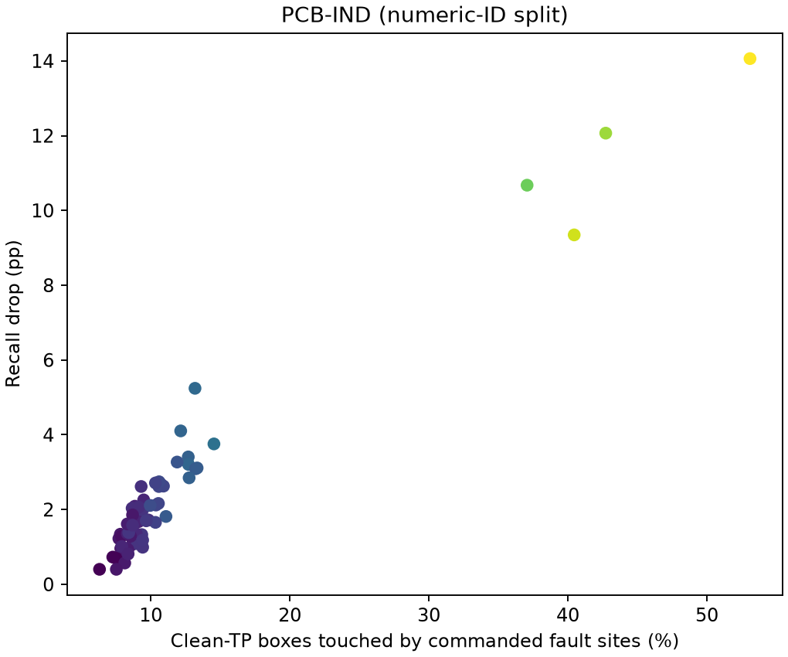
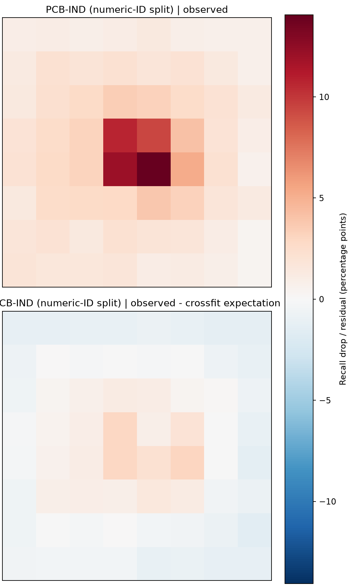

# 기존 캐시의 제품 결함 분포·겹침 진단

## 자료와 정의

밝은 화소25개, 8×8위치, 분산형 패턴10개의 저장 예측을 사용했다. 모델 또는 입력 영상을 새로 추론하지 않았다. confidence와 matching IoU는 각 run의 기존 설정을 유지했다. 원본과 손상 예측은 같은 클래스·IoU의 일대일 대응으로 각 GT 객체의 검출 여부를 계산했다.

- **손실:** clean에서는 검출됐지만 fault에서는 검출되지 않은 GT.
- **회복:** clean에서는 미검출이었지만 fault에서는 검출된 GT.
- **겹침:** 주입 대상으로 지정한 좌표 중 하나 이상이 GT 상자 내부에 있음. 상자는 0-based half-open으로 계산했다. 원래255였던 좌표도 주입 대상에 포함하므로 실제 변경 화소와 일치하지 않을 수 있다.
- **중앙:** 가로·세로의 중앙25% 구간(.375~.625), 즉 영상 면적6.25% 영역에 GT 상자 중심이 있는 경우.
- **크기:** 데이터셋별 상대 GT 상자 면적을 3분위로 분류했다. 원본 데이터 객체를 기준으로 경계를 정하며 반복 관측으로 다시 정하지 않는다.

## 결함 분포와 노출

| 데이터셋 | 중앙 결함 중심 비율 | 정답 상자 면적 중앙값 | 최대 감소 위치 | 최대 위치 clean TP 겹침 | 감소–노출 순위상관 |
|---|---:|---:|---|---:|---:|
| PCB-IND (numeric-ID split) | 50.95% | 1399.0px² | G37 (14.061%p) | 53.10% | 0.889 |

## 객체별 손실·회복

| 데이터셋 | 겹친 clean TP의 손실률 | 비겹침 clean TP의 손실률 | 손실 객체 중 겹침 비율 | 원래 위치차 표준편차 | 교차적합 잔차 RMS |
|---|---:|---:|---:|---:|---:|
| PCB-IND (numeric-ID split) | 15.664% | 2.301% | 47.38% | 2.557%p | 1.073%p |

이 비율의 분모는 반복된 **객체 관측 수**다. 같은 원본 객체가640번 재사용되므로 독립 객체 수로 해석하거나 단순 이항 신뢰구간을 붙이지 않았다. 클래스·크기·겹침 화소수별 모든 손실/회복 분모와 분자는 `*_class_size_hit_strata.csv`에 있다. 각 칸과 패턴별 집계는 `*_pattern_cell_events.csv`에 보존했다.

## cell을 사용하지 않는 기술적 기준모형

클래스×크기3분위×상자 안 주입 화소수(none/one/2~4/5+)로 원래 검출 상태에 따른 손실/회복률을 학습했다. 위치 번호(cell)는 예측변수로 사용하지 않았다. 같은 이미지 그룹이 학습·평가 fold에 함께 들어가지 않도록 그룹5-fold 교차적합(seed8811)을 사용했다. PCB는 t/b를 합친 숫자 접두어를 fold 그룹으로 사용했고 다른 데이터는 저장된group_id를 사용했다. 숫자 접두어의 실제 제품 정체성이 확인된 것은 아니다.

평가 fold의 표본이 없는 세부 층은 클래스 제거→크기 제거→겹침 제거 순서로 더 넓은 학습 층의 비율을 사용했다. 모든 fallback 관측 수를 summary JSON에 기록했다. 이 모형이 각 위치의 객체 노출 구성에서 예측한 순손실(예상손실−예상회복)을 기존 Recall 감소에서 뺀 값을 **기술적 잔차**로 표시한다.

겹침·클래스·크기 구성만으로 원래 공간 패턴이 얼마나 재현되는지 보는 진단이며 **인과적 위치 효과를 분리했다고 주장하지 않는다.** 상자 안에서도 실제 결함 픽셀·세부 구조·손상 대비·confidence·NMS·문맥이 다를 수 있다. 잔차가 남아도 센서 위치 고유 취약성의 증거가 아니며, 잔차가 줄어도 원인을 모두 설명했다는 뜻은 아니다. 순위상관도 교란 제거 또는 독립성 검정이 아니다.

## 실험 범위

단일 학습 시드와 해당 시험 분할에 조건부인 탐색 분석이다.

pcb_ind_board: 대응 canonical manifest의 해시를 확인하고 숫자 ID를 직접 점검했다. 여러 분할에 걸치는 ID는 0개, 학습–시험 중복은 0개로, 학습/검증/시험 숫자 그룹 수는 {'train': 478, 'test': 103, 'val': 102}다. 숫자 ID 단위 분리는 확인됐지만 실제 물리 보드 또는 코일의 정체성이 확인된 것은 아니다. 기존 공식 분할과 시험 영상·정답·학습 모델이 달라진 별도 코호트이므로 두 결과의 차이를 분할 중복 해소의 인과 효과로 단정하지 않는다.

데이터셋별 해상도와 resize 배율 차이, 미확인 실제 코일/보드 독립성, GT 상자의 느슨함, 25개 주입 대상 중 실제 무변화 좌표도 해석에 남는다.

입력 run hash·예측 파일 SHA256·분석 코드 해시는 `*_sources.json`에 기록했다. 객체 집계에서 재계산한 모든64개 위치 Recall 감소가 기존 `grid_summary.csv`와1e-10 이내로 일치함을 검사했다.
