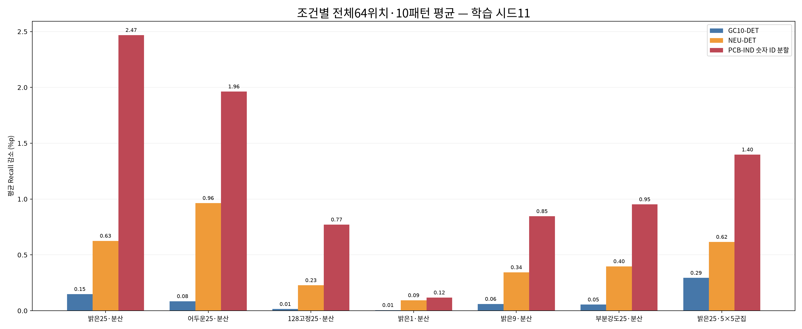
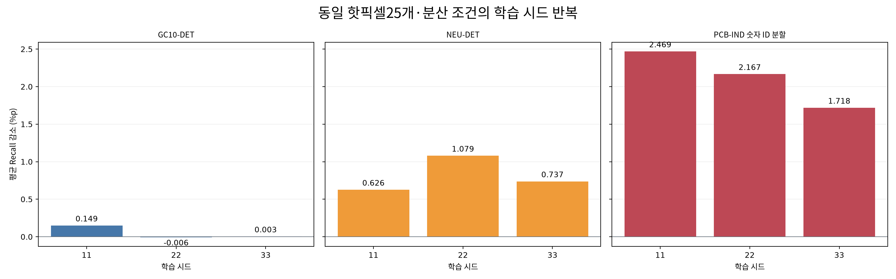
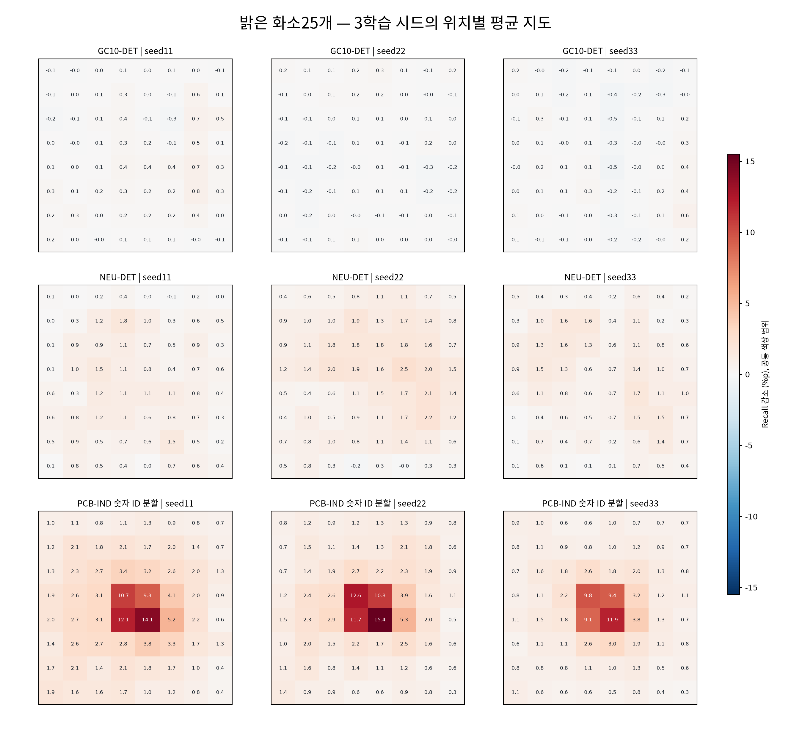

# 제조 화소 손상 연구 — 추가 검증 결과

**실행 완료 범위:** 3개 데이터셋, 학습 시드11·22·33, 총27개 모델/조건 평가를 완료했다. 각 평가는8×8위치·분산형 배치10개(군집 조건은5×5블록10개)와 고정된 시험자료를 사용한다. 모든640개 위치/패턴 평가를 평균했으며 결과에 따라 위치나 패턴을 제외하지 않았다.

## 핵심 비교의 정의

- 모든 모델의 학습 args에서 시드와 데이터 분할을 확인했고, 초기 COCO체크포인트 해시와 학습 recipe가 같음을 검사했다.
- 각 학습 모델·전처리·평가 임계값을 고정한 뒤 손상을 원본 영상 좌표에 주입한다. 각 조건마다 clean1+64×10=641개 예측 묶음이다.
- Recall/Precision은 고정 confidence0.25, 동일 클래스·IoU0.5 대응으로 계산한다. AP는 floor0.001로 보존한 예측을 동일 COCO evaluator로 평가한다.
- 각 위치의 지표는 시험자료 전체를 평가한 값이다. 이를64위치와10패턴에 동일 가중치로 평균한다. 서로 다른 조건의 예측을 한 영상에 합쳐 AP를 계산하지 않는다.
- **감소량=원본−주입 후**이므로 양수는 악화, 음수는 개선이다. 패턴 번호는 데이터셋 내부의 난수 배치 번호이며 데이터셋 간 같은 형상을 뜻하지 않는다.
- 유형 비교는 모두25화소, 강도 비교도25화소를 유지한다. 군집은5×5=25화소로 분산25와 개수를 맞췄다. 실제 변경 수는 원래 값과 같으면 줄 수 있어 CSV에 보존했다.

## 원본 시험 성능

| 데이터셋 | 시드 | 완료 epoch | 시험 영상 | GT | 원본 Recall (%) | 원본 Precision (%) | 원본 mAP50 (%) | 원본 mAP50:95 (%) |
| --- | --- | --- | --- | --- | --- | --- | --- | --- |
| GC10-DET | 11 | 31 | 354 | 587 | 45.145 | 65.271 | 49.137 | 23.717 |
| GC10-DET | 22 | 39 | 354 | 587 | 51.107 | 58.708 | 50.400 | 23.190 |
| GC10-DET | 33 | 61 | 354 | 587 | 52.300 | 59.728 | 50.712 | 24.046 |
| NEU-DET | 11 | 53 | 270 | 612 | 69.608 | 65.639 | 69.267 | 36.359 |
| NEU-DET | 22 | 76 | 270 | 612 | 64.379 | 72.560 | 67.603 | 36.034 |
| NEU-DET | 33 | 100 | 270 | 612 | 61.111 | 73.190 | 66.098 | 35.823 |
| PCB-IND 숫자 ID 분할 | 11 | 94 | 639 | 948 | 69.726 | 74.943 | 64.516 | 44.666 |
| PCB-IND 숫자 ID 분할 | 22 | 79 | 639 | 948 | 69.620 | 73.991 | 64.235 | 44.958 |
| PCB-IND 숫자 ID 분할 | 33 | 64 | 639 | 948 | 70.359 | 68.621 | 62.791 | 43.203 |

## 유형·화소수·강도·군집 비교: 시드11

| 데이터셋 | 주입 조건 | 평균 Recall (%) | Recall 감소 (%p) | 평균 Precision (%) | 평균 mAP50 (%) | 평균 mAP50:95 (%) |
| --- | --- | --- | --- | --- | --- | --- |
| GC10-DET | 밝은25·분산 | 44.996 | 0.149 | 65.592 | 48.952 | 23.591 |
| GC10-DET | 어두운25·분산 | 45.060 | 0.085 | 65.026 | 48.987 | 23.640 |
| GC10-DET | 128고정25·분산 | 45.130 | 0.015 | 65.383 | 49.110 | 23.687 |
| GC10-DET | 밝은1·분산 | 45.139 | 0.005 | 65.347 | 49.127 | 23.703 |
| GC10-DET | 밝은9·분산 | 45.084 | 0.060 | 65.508 | 49.074 | 23.659 |
| GC10-DET | 부분강도25·분산 | 45.090 | 0.055 | 65.489 | 49.088 | 23.665 |
| GC10-DET | 밝은25·5×5군집 | 44.851 | 0.294 | 61.647 | 48.369 | 23.438 |
| NEU-DET | 밝은25·분산 | 68.982 | 0.626 | 65.773 | 68.457 | 35.931 |
| NEU-DET | 어두운25·분산 | 68.644 | 0.964 | 65.564 | 68.014 | 35.707 |
| NEU-DET | 128고정25·분산 | 69.380 | 0.228 | 65.741 | 68.801 | 36.208 |
| NEU-DET | 밝은1·분산 | 69.515 | 0.093 | 65.723 | 69.071 | 36.309 |
| NEU-DET | 밝은9·분산 | 69.264 | 0.344 | 65.837 | 68.794 | 36.172 |
| NEU-DET | 부분강도25·분산 | 69.210 | 0.398 | 65.760 | 68.706 | 36.107 |
| NEU-DET | 밝은25·5×5군집 | 68.992 | 0.616 | 65.421 | 68.397 | 35.871 |
| PCB-IND 숫자 ID 분할 | 밝은25·분산 | 67.257 | 2.469 | 73.515 | 61.682 | 42.535 |
| PCB-IND 숫자 ID 분할 | 어두운25·분산 | 67.763 | 1.963 | 74.679 | 63.224 | 43.543 |
| PCB-IND 숫자 ID 분할 | 128고정25·분산 | 68.955 | 0.771 | 74.804 | 63.770 | 44.059 |
| PCB-IND 숫자 ID 분할 | 밝은1·분산 | 69.608 | 0.118 | 74.927 | 64.436 | 44.569 |
| PCB-IND 숫자 ID 분할 | 밝은9·분산 | 68.880 | 0.846 | 74.936 | 63.761 | 44.015 |
| PCB-IND 숫자 ID 분할 | 부분강도25·분산 | 68.773 | 0.952 | 74.871 | 63.665 | 43.972 |
| PCB-IND 숫자 ID 분할 | 밝은25·5×5군집 | 68.328 | 1.398 | 71.165 | 63.156 | 43.400 |

## 조건을 맞춘 차이

표의 값은 첫 조건의 감소량−둘째 조건의 감소량이다. 양수면 첫 조건의 악화가 더 크다. 같은 패턴 번호의64위치 평균끼리 차이를 구했다. 유형(밝음·어두움·128고정)과 강도 비교는 동일한25개 분산 좌표를 사용한다. 화소수1·9는 같은 순서로 생성한25개 패턴의 앞부분을 사용하므로 좌표가 중첩된다. 군집5×5는 별도의layout/side seed를 사용해 실제 좌표와GT노출도 달라진다. 군집−분산 대비는 명령 화소 수와큰 격자 위치를 맞춘 비교이며, 노출을 고정한 연결성만의 인과적 효과가 아니다. 표준편차는10개 패턴 차이의 변동으로, 신뢰구간 또는 학습 시드 변동이 아니다.

| 데이터셋 | 첫 조건−둘째 조건 | 감소량 차이 (%p) | 패턴 차이 표준편차 (%p) | mAP50 감소량 차이 (%p) |
| --- | --- | --- | --- | --- |
| GC10-DET | 화소수9−1 | 0.055 | 0.052 | 0.053 |
| GC10-DET | 화소수25−9 | 0.088 | 0.051 | 0.122 |
| GC10-DET | 화소수25−1 | 0.143 | 0.066 | 0.175 |
| GC10-DET | 어두움−밝음 | -0.064 | 0.041 | -0.035 |
| GC10-DET | 128고정−밝음 | -0.134 | 0.053 | -0.158 |
| GC10-DET | 완전−부분강도 | 0.094 | 0.040 | 0.136 |
| GC10-DET | 군집−분산 | 0.145 | 0.053 | 0.583 |
| NEU-DET | 화소수9−1 | 0.250 | 0.072 | 0.276 |
| NEU-DET | 화소수25−9 | 0.282 | 0.049 | 0.337 |
| NEU-DET | 화소수25−1 | 0.533 | 0.052 | 0.614 |
| NEU-DET | 어두움−밝음 | 0.338 | 0.089 | 0.443 |
| NEU-DET | 128고정−밝음 | -0.398 | 0.043 | -0.344 |
| NEU-DET | 완전−부분강도 | 0.228 | 0.048 | 0.249 |
| NEU-DET | 군집−분산 | -0.010 | 0.094 | 0.060 |
| PCB-IND 숫자 ID 분할 | 화소수9−1 | 0.729 | 0.221 | 0.675 |
| PCB-IND 숫자 ID 분할 | 화소수25−9 | 1.622 | 0.357 | 2.079 |
| PCB-IND 숫자 ID 분할 | 화소수25−1 | 2.351 | 0.326 | 2.754 |
| PCB-IND 숫자 ID 분할 | 어두움−밝음 | -0.506 | 0.164 | -1.542 |
| PCB-IND 숫자 ID 분할 | 128고정−밝음 | -1.697 | 0.205 | -2.088 |
| PCB-IND 숫자 ID 분할 | 완전−부분강도 | 1.516 | 0.181 | 1.982 |
| PCB-IND 숫자 ID 분할 | 군집−분산 | -1.070 | 0.232 | -1.473 |

## 학습 시드 반복: 밝은25화소·분산

| 데이터셋 | 시드 | 평균 Recall 감소 (%p) | 평균 mAP50 감소 (%p) | 관찰 최대 칸 | 최대 칸 평균 감소 (%p) |
| --- | --- | --- | --- | --- | --- |
| GC10-DET | 11 | 0.149 | 0.186 | G47 | 0.801 |
| GC10-DET | 22 | -0.006 | 0.308 | G5 | 0.324 |
| GC10-DET | 33 | 0.003 | 0.102 | G56 | 0.613 |
| NEU-DET | 11 | 0.626 | 0.809 | G12 | 1.781 |
| NEU-DET | 22 | 1.079 | 0.622 | G30 | 2.516 |
| NEU-DET | 33 | 0.737 | 0.796 | G38 | 1.748 |
| PCB-IND 숫자 ID 분할 | 11 | 2.469 | 2.833 | G37 | 14.061 |
| PCB-IND 숫자 ID 분할 | 22 | 2.167 | 3.961 | G37 | 15.411 |
| PCB-IND 숫자 ID 분할 | 33 | 1.718 | 3.920 | G37 | 11.930 |

| 데이터셋 | Recall 감소 시드평균 (%p) | 시드 표준편차 (%p) | mAP50 감소 시드평균 (%p) | 시드 표준편차 (%p) | 시드별 최대 칸 |
| --- | --- | --- | --- | --- | --- |
| GC10-DET | 0.049 | 0.087 | 0.199 | 0.104 | s11:G47;s22:G5;s33:G56 |
| NEU-DET | 0.814 | 0.236 | 0.742 | 0.105 | s11:G12;s22:G30;s33:G38 |
| PCB-IND 숫자 ID 분할 | 2.118 | 0.378 | 3.571 | 0.640 | s11:G37;s22:G37;s33:G37 |

세 시드의 평균과 표본 표준편차(ddof=1)를 보고했다. 시드3개만으로 모든 모델·촬영환경의 재현성을 보장하지 않는다. 최대 칸은 각 지도에서 사후 선택한 기술통계다.

| 데이터셋 | 시드A | 시드B | 지도 Pearson r | 지도 Spearman ρ | 상위4칸 Jaccard |
| --- | --- | --- | --- | --- | --- |
| GC10-DET | 11 | 22 | -0.108 | -0.070 | 0.000 |
| GC10-DET | 11 | 33 | 0.113 | 0.173 | 0.000 |
| GC10-DET | 22 | 33 | -0.335 | -0.351 | 0.000 |
| NEU-DET | 11 | 22 | 0.406 | 0.422 | 0.143 |
| NEU-DET | 11 | 33 | 0.434 | 0.430 | 0.143 |
| NEU-DET | 22 | 33 | 0.641 | 0.636 | 0.000 |
| PCB-IND 숫자 ID 분할 | 11 | 22 | 0.983 | 0.890 | 1.000 |
| PCB-IND 숫자 ID 분할 | 11 | 33 | 0.980 | 0.866 | 1.000 |
| PCB-IND 숫자 ID 분할 | 22 | 33 | 0.987 | 0.884 | 1.000 |

지도 상관과 상위4칸 겹침은 기술적 일치도다. Jaccard는 두 상위4칸 집합의 교집합/합집합이며, 동점은 작은 칸 번호를 우선했다. 이는 위치 차이의 유의성 검정이 아니다.

## PCB 기존 공식분할과 숫자 ID 분할

기존 공식분할에서 숫자 ID 683개 중 124개가 여러 분할에 걸쳤고, 63개는 학습과 시험에 함께 있었다. 새 분할은 숫자 ID별로 t/b양면과 모든 패치를 묶었고 분할 간 교집합은0이다. 기존 양성4662장과 주석을 보존했다.

| 분할 | 시험 영상 | GT | 원본 Recall (%) | 주입 후 평균 Recall (%) | Recall 감소 (%p) | 원본 mAP50 (%) | 주입 후 mAP50 (%) |
| --- | --- | --- | --- | --- | --- | --- | --- |
| 기존 공식 분할 | 469 | 547 | 69.104 | 67.052 | 2.052 | 56.951 | 53.649 |
| 숫자 ID 분할 | 639 | 948 | 69.726 | 67.257 | 2.469 | 64.516 | 61.682 |

**시험 코호트가 서로 다르다.** 클래스 구성·객체수·영상 조건도 바뀌므로 성능 차이를 정보누수 제거만의 인과적 효과라고 해석하지 않는다. 숫자 ID 역시 실제 물리 보드임이 확인된 값이 아니라 보수적인 대리 그룹이다. 새 PCB의 패턴 namespace는pcb_ind로 고정해 같은 원본 해상도에서 기존과 같은 마스크 형상을 사용했다.

[PCB 재분할 검증](../pcb_split/REPORT_KO.md)

## 기존 공식분할 단일시드의 분포·겹침 분석

| 데이터셋 | 중앙 결함 중심 비율 | 관찰 최대 칸 | 최대 감소 (%p) | 최대 칸 cleanTP 겹침 | 감소−노출 순위상관 | 교차적합 기술잔차 RMS (%p) |
| --- | --- | --- | --- | --- | --- | --- |
| GC10-DET | 4.60% | G47 | 0.801 | 11.09% | 0.255 | 0.238 |
| NEU-DET | 15.03% | G12 | 1.781 | 33.38% | 0.691 | 0.316 |
| PCB-IND | 66.54% | G37 | 14.918 | 70.90% | 0.881 | 1.313 |

중앙은 가로·세로 중앙25%, 영상면적6.25%다. 상자 겹침·클래스·객체 크기를 이용한 교차적합 진단은 인과적 위치 효과를 제거한 결과가 아니다. 잔차 감소나 상관만으로 원인을 확정하지 않는다.

[상세 방법·수치](../distribution/REPORT_KO.md)
## 기존 공식분할 단일시드의 위치 공동 밴드

| 자료 | 재표집 그룹 | 전체평균 감소 (%p) | 평균 구간 하한 (%p) | 평균 구간 상한 (%p) | 평균보다 높은 칸 | 동일 위치효과 벡터가 공동영역 안에 있음 |
| --- | --- | --- | --- | --- | --- | --- |
| gc10_det | recorded_groups | 0.149 | 0.036 | 0.296 | 없음 | True |
| neu_det | recorded_groups | 0.626 | 0.167 | 1.098 | 없음 | True |
| pcb_ind | recorded_groups | 2.052 | 1.313 | 3.118 | G36,G37 | False |
| pcb_ind | numeric_id_groups | 2.052 | 1.294 | 3.154 | G36,G37 | False |

같은 이미지 그룹과 패턴의 재표집 가중치를64위치에 공통 적용한 명목95% 근사 동시 밴드다. 위치별 편차는 전체 위치 평균과의 차이다. 확증적 p-value 또는 센서 고유 위치의 인과 효과를 뜻하지 않는다. 숫자 ID 재표집만으로 학습–시험 중복이 제거되지는 않는다.

[상세 방법·수치](../positions/REPORT_KO.md)
## 새 PCB 숫자 ID 분할의 분포·겹침 분석

| 데이터셋 | 중앙 결함 중심 비율 | 관찰 최대 칸 | 최대 감소 (%p) | 최대 칸 cleanTP 겹침 | 감소−노출 순위상관 | 교차적합 기술잔차 RMS (%p) |
| --- | --- | --- | --- | --- | --- | --- |
| PCB-IND (numeric-ID split) | 50.95% | G37 | 14.061 | 53.10% | 0.889 | 1.073 |

중앙은 가로·세로 중앙25%, 영상면적6.25%다. 상자 겹침·클래스·객체 크기를 이용한 교차적합 진단은 인과적 위치 효과를 제거한 결과가 아니다. 잔차 감소나 상관만으로 원인을 확정하지 않는다.

[상세 방법·수치](../corrected_pcb_distribution/REPORT_KO.md)
## 새 PCB 숫자 ID 분할의 위치 공동 밴드

| 자료 | 재표집 그룹 | 전체평균 감소 (%p) | 평균 구간 하한 (%p) | 평균 구간 상한 (%p) | 평균보다 높은 칸 | 동일 위치효과 벡터가 공동영역 안에 있음 |
| --- | --- | --- | --- | --- | --- | --- |
| pcb_ind_board_s11 | recorded_groups | 2.469 | 1.915 | 3.038 | G28,G29,G36,G37 | False |
| pcb_ind_board_s11 | numeric_id_groups | 2.469 | 1.915 | 3.038 | G28,G29,G36,G37 | False |

같은 이미지 그룹과 패턴의 재표집 가중치를64위치에 공통 적용한 명목95% 근사 동시 밴드다. 위치별 편차는 전체 위치 평균과의 차이다. 확증적 p-value 또는 센서 고유 위치의 인과 효과를 뜻하지 않는다. 숫자 ID 재표집만으로 학습–시험 중복이 제거되지는 않는다.

[상세 방법·수치](../corrected_pcb_positions/REPORT_KO.md)

## 실행 검증과 수치 동등성

실행 경로 인증서의 고정 validation control검사는 총24건이다. 원래batch16을 유지했고, 전체 예측 사전과 이미지별TP/FP/FN·GT매칭이 일치했으며 COCO AP 차이의 최댓값은0였다. 더 큰 batch의 작은 수치 차이는 채택하지 않았다. 이는 제한된 고정 control의 수치 동등성 검증이며 모든 새 체크포인트에 대한 수학적 보장은 아니다. 내부 전처리·inference·후처리는 고정 버전의 같은 Ultralytics predictor 단계를 사용했다.

[compiled 경로 인증서](../compiled_backend_validation.json)

새 체크포인트별 인증서도9개를 확인했다. 각 인증서는 해당 가중치와 현재 데이터·클래스·조건·실행 소스를 지문으로 묶고, validation17장(16장전체배치+1장부분배치)에서clean+7조건 전체 예측 일치를 검사한다. 선택한영상ID가실제validation분할에속함도확인했다. 이것도 제한된control검사이며 임의입력의 수학적동등성보장은아니다.

Compiled 경로는 원래 scores.argsort 순서를 rank로 보존하고 원본 confidence는 바꾸지 않는다. 후보수2048초과·비정상/퇴화·비유한값 또는 IoU기준±1e-5근방이면 원래TorchNMS로 복귀한다. 최종 완료 표식에 기록한 NMS호출7,142,346회 중 compiled호출7,103,676회, IoU경계fallback38,670회다. 이 수는 완료 예측의 호출만 합산한다.

완료 상태와 실제 파일을 확인한 총27개 평가, 예측 묶음17,307개, 논리적 이미지 평가7,286,247회다. 완료 표식 기준 신규7,286,247회, 명시적 재사용0회, 쌍체 이미지 행7,274,880개다. 원래 분석기가 각 예측의 SHA256을 검사했다. 본 보고서는 완료 상태·run/analysis hash·전체 위치/패턴 수·모델/데이터 일관성을 추가 검사했다. 예측 파일 재해시 옵션 사용 여부는True다. 원본·조건별 예측과 코드·데이터·가중치·수치표 해시를 보존했다. 위 횟수는 최종27작업의 완료 예측만 합산하며 보존된eager부분실행·수치검증·프로토타입의 중간계산은 포함하지 않는다.

## 결과를 해석하는 범위

이번 유형·강도 비교는 처리된RGB영상에서의 합성 손상이다. hot-like는255치환, dead-like는0치환, stuck-like는128치환이며 온도·노출 의존 센서의 물리적 고장 모델은 아니다. 실제 RAW·ISP·DPC 또는 출하 불량률을 검증하지 않았다.

GC10은2048×1000, NEU는200×200, PCB는300×300 원본을 사용하므로 같은25화소라도 면적 비율과 YOLO전처리 후 크기가 다르다. 데이터셋 간 차이를 제조 대상이나 센서의 본질적인 민감도 차이 하나로 설명할 수 없다. 기존과 새 PCB 자료는 양성 영상만 사용하며 정상제품 오거부율을 의미하지 않는다. 실제 코일·제품의 독립성도 확인된 범위까지만 해석한다.

시드 반복, 조건 비교, 공동밴드, 겹침 진단은 서로 다른 질문을 다룬다. 탐색에 사용한 자료의 추가 분석이므로 독립 확증 실험 또는 모든 비교에 걸친 전체 오류율 보장이라고 주장하지 않는다.

## 파일

- [27개 모델/조건 평균](condition_means.csv)
- [패턴별 평균 전체](pattern_means.csv)
- [원본 기준 성능9개](clean_baselines.csv)
- [밝은25화소 시드별 결과](bright25_seed_results.csv)
- [3시드 평균·표준편차](bright25_seed_summary.csv)
- [시드 간 지도 상관·최대위치 비교](seed_spatial_correlations.csv)
- [조건을 맞춘 대비](matched_budget_contrasts.csv)
- [PCB 두 시험 코호트의 별도 비교](pcb_official_vs_numeric_group.csv)
