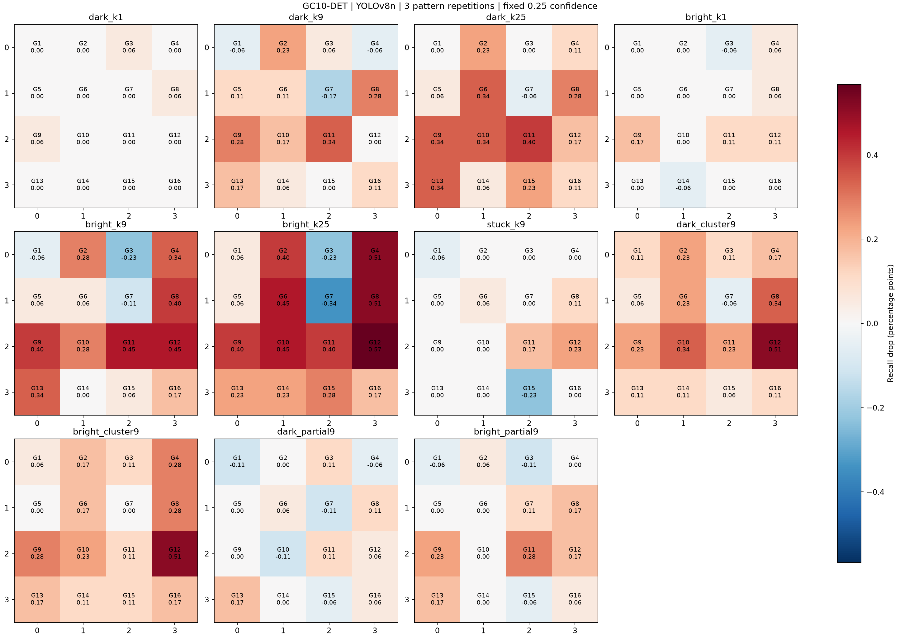
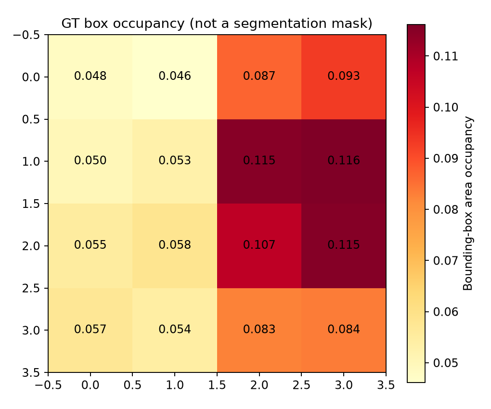
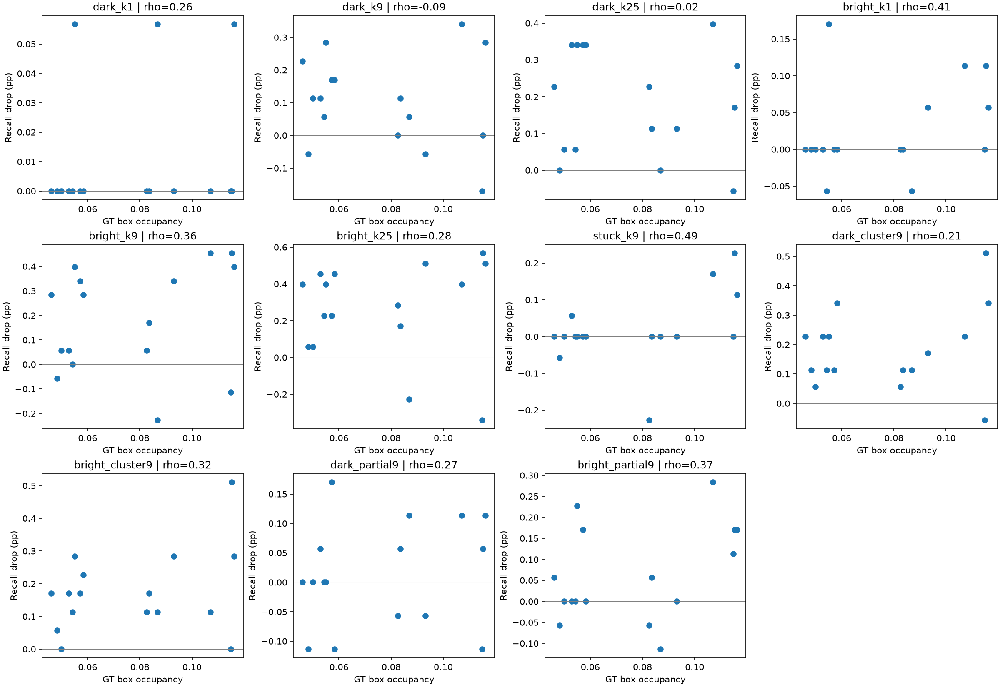
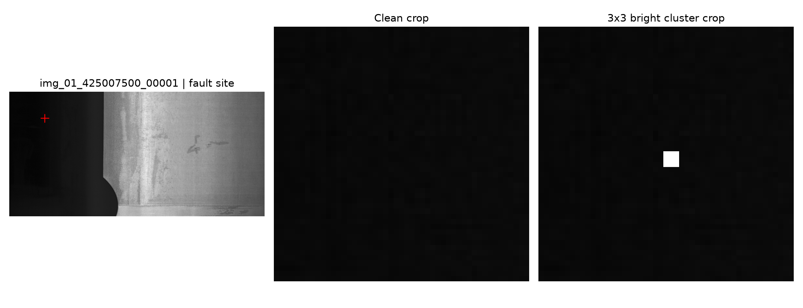

# GC10-DET 화소 손상 위치별 민감도 실험 결과

## 실행 범위

실제 GC10 영상에서 YOLOv8n을 학습하고 동일한 모델로 원본/손상 추론 및 평가를 완료했다. 단일 데이터셋과 학습 시드 11에 대한 결과이며 반복 학습 시드와 다른 제조 데이터셋 재현성은 아직 검증하지 않았다.

## 데이터와 분할

- 출처: [dronefreak/GC10-DET](https://huggingface.co/datasets/dronefreak/GC10-DET), revision `42c086fa8dea913987febe794b1e7608b3db464d`. 원저자 직접 배포본이 아닌 Dataset Ninja 기반 비공식 재배포본이다.
- 원본 2300장; 사용 2292장. 주석 없는 영상 8장은 정상 여부가 확인되지 않아 제외했다. 정확히 동일한 decoded 영상의 제외 수: 0.
- 실제 분할: {'train': 1639, 'val': 299, 'test': 354}. 파일명의 마지막 프레임 번호를 제외한 접두어를 그룹으로 간주하여 seed=101, 그룹 수 기준 70/15/15 분할했다.
- 기본 배포 분할에서 접두어 그룹 142개가 분할 경계를 넘었다. 재분할 후 동일 접두어는 하나의 분할에만 존재한다. 접두어는 촬영 시퀀스의 대리값이며 실제 코일/제품 독립성을 보장하지 않는다. 근접 중복의 시각 검수는 수행하지 않았다.

## 사전에 고정한 설정

Ultralytics 8.3.221, COCO 사전학습 `yolov8n.pt`, imgsz=640, 최대 100 epoch, patience=20, AdamW lr=0.001, batch=16. 검증 데이터 기준 best.pt 사용. 실제 완료 epoch: 31. 합성 손상 없이 학습했으며 공간/색상 증강은 0으로 설정했다.

손상은 원본 해상도 RGB에 주입한 뒤 YOLO 전처리를 통과한다. 4×4 격자, 조건 11개, 패턴 3회 반복. 고립 화소 1/9/25개, 검정/밝은 고정값, 128 고정값, 3×3 군집, alpha=0.5 부분 변화. `hot_like`는 255 치환이며 온도/노출에 따른 dark-current 물리 모형은 아니다. 손상량과 세부 패턴은 `configs/gc10_frozen.yaml`에 있으며 시험 결과를 보기 전에 고정했다.

같은 해상도에서는 동일 반복의 패턴을 이미지마다 유지하고 격자 위치만 이동한다. 클래스, 조건, 위치에 따라 평가 기준을 재조정하지 않는다. conf=0.25, class-aware score-first matching, IoU=0.5. AP는 COCO 공식 평가기, conf floor=0.001, maxDets=100을 사용한다.

## 원본 시험 성능

| 지표 | 값 |
|---|---:|
| 시험 이미지 | 354 |
| GT 제품 결함 | 587 |
| TP / FP / FN | 265 / 141 / 322 |
| Recall | 45.145% |
| Precision | 65.271% |
| COCO mAP50 | 49.137% |
| COCO mAP50:95 | 23.717% |

클래스별 원본 성능은 `clean_per_class.csv`에 저장했다. 이 원본 기준도 미검출을 포함하므로 높은 신뢰성의 산업 배포 성능으로 해석하지 않는다.

## 위치별 변화

아래 평균은 16개 위치와 3개 패턴 반복의 평균이다. 양수는 원본보다 성능 감소, 음수는 증가다. 최대 위치는 사후 기술통계이며 유의한 취약 위치로 확정하지 않는다.

| 조건 | 평균 Recall 감소 (%p) | 위치별 최소~최대 (%p) | 최대 위치 | 평균 mAP50 감소 (%p) |
|---|---:|---:|---|---:|
| dark_k1 | 0.0106 | 0.0000 ~ 0.0568 | G3 | 0.0050 |
| dark_k9 | 0.1029 | -0.1704 ~ 0.3407 | G11 | 0.1250 |
| dark_k25 | 0.1846 | -0.0568 ~ 0.3975 | G11 | 0.2773 |
| bright_k1 | 0.0248 | -0.0568 ~ 0.1704 | G9 | 0.0183 |
| bright_k9 | 0.1810 | -0.2271 ~ 0.4543 | G11 | 0.2882 |
| bright_k25 | 0.2591 | -0.3407 ~ 0.5679 | G12 | 0.3194 |
| stuck_k9 | 0.0177 | -0.2271 ~ 0.2271 | G12 | 0.0560 |
| dark_cluster9 | 0.1810 | -0.0568 ~ 0.5111 | G12 | 0.3295 |
| bright_cluster9 | 0.1739 | 0.0000 ~ 0.5111 | G12 | 0.2200 |
| dark_partial9 | 0.0142 | -0.1136 ~ 0.1704 | G13 | -0.0024 |
| bright_partial9 | 0.0639 | -0.1136 ~ 0.2839 | G11 | 0.1044 |

관찰한 가장 큰 위치별 평균 Recall 감소는 `bright_k25`의 G12에서 0.5679%p였다. 단일 GT의 검출 여부도 작은 시험집합에서는 지도 값에 영향을 준다. 작은 손상은 resize로 약화될 수 있으며, 효과가 작거나 개선된 조건도 모두 유지했다.

`grid_summary.csv`의 95% 구간은 이미지 접두어 그룹과 패턴 반복을 함께 재표집한 **위치별 쌍체 bootstrap 구간**이다. 지도 전체 동시 구간·다중 비교 보정 또는 학습 시드 불확실성을 포함하지 않는다. 각 위치의 구간이 0을 벗어났다는 이유만으로 위치 간 차이를 검증했다고 주장할 수 없다.

GT 분포는 bounding box 점유율이며 실제 결함 픽셀 마스크가 아니다. 격자 16칸의 순위 상관은 기술적 보조 분석으로 `occupancy_correlations.json`에 저장했다. 상관만으로 위치 효과의 교란을 통제한 것은 아니다.

## 실행 증거와 재현

완료된 추론 shard 529개, 합계 187,266장 평가, 두 GPU 평가 경과시간 약 17.7분, 개별 추론 shard 시간 합계 34.0분(병렬 작업의 합계). 모델/데이터/조건/코드/패키지 버전 해시는 `run_meta.json`과 `analysis_meta.json`에 기록했다. 원본·조건별 예측 JSONL과 완료 SHA256을 보존했다. 기능 테스트와 COCO 평가기는 실제 환경에서 실행했다. 정확한 재실행 순서는 프로젝트 루트 `README.md`를 따른다.

## 해석의 범위

이 결과는 공개 이미지 좌표에서 합성 화소 이상을 넣었을 때 고정된 검출 모델의 출력 변화를 측정한다. 실제 센서 RAW, demosaic, DPC, 센서 수명, 실제 제품 출하 불량률은 검증하지 않았다. 추가 시드/데이터셋, 물리적 센서 결함, 제품별 독립성 확인을 거쳐야 일반화할 수 있다.
