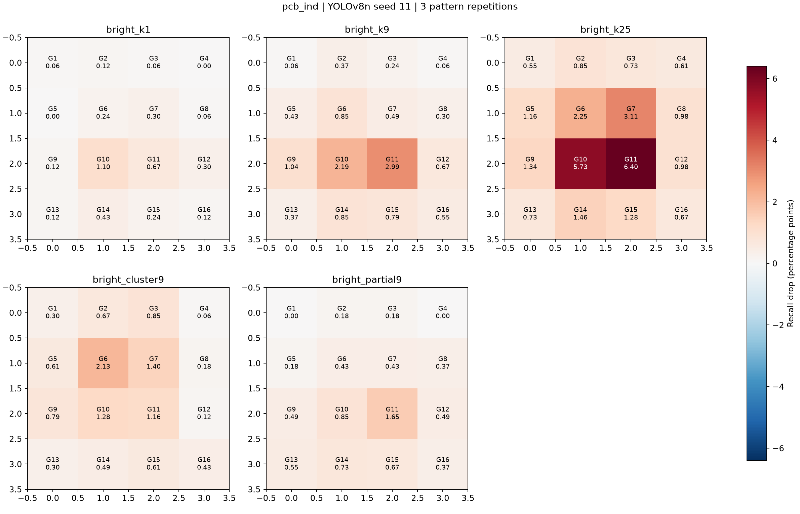
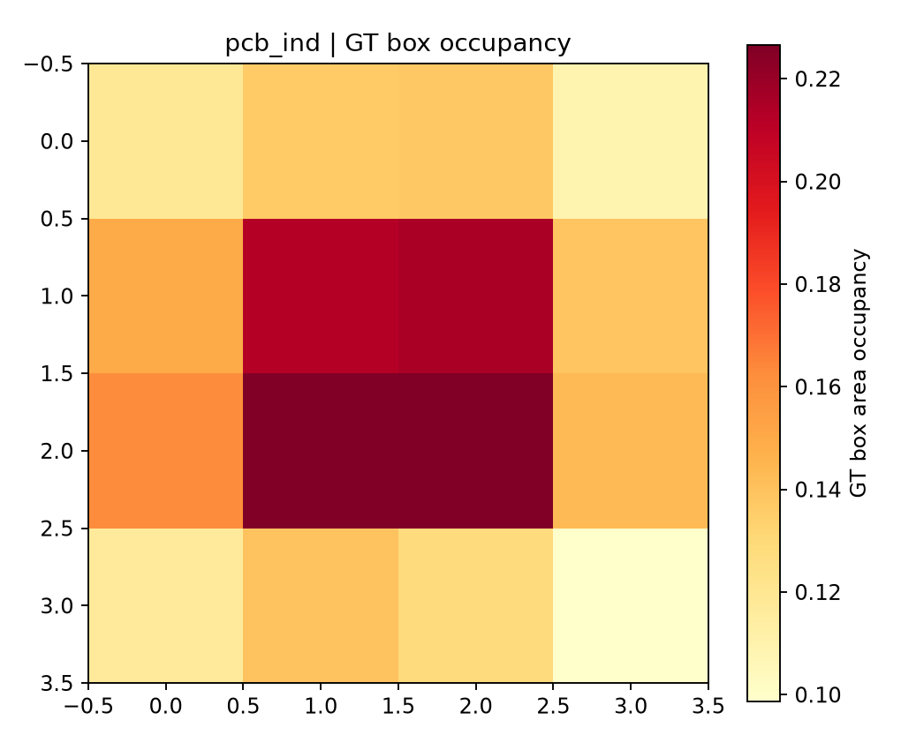

# pcb_ind 밝은 화소 손상 위치별 민감도 실험

GC10과 동일한 YOLOv8n 학습 설정과 밝은 화소 손상 조건을 적용했다. 데이터셋마다 동일한 원본 COCO 사전학습 체크포인트에서 독립 학습했다. 단일 학습 시드(11)의 실험이다.

## 데이터 준비

원본 4789장 중 4662장 사용. 분할: {'test': 469, 'train': 3718, 'val': 475}. 데이터 출처와 압축 파일 해시는 `data/raw/pcb_ind/provenance.json`에, 중복·주석·분할 기록은 `inputs/pcb_ind_source_audit.json`에 보존했다.

분할 규칙: Official v4 80/10/10 split retained; filename prefix groups checked disjoint across splits.
좌표 규칙: Official COCO xywh -> 0-based half-open; native COCO coordinates avoid 6-decimal YOLO boundary rounding.
Difficult 처리: Not applicable: official YOLO labels contain no difficult flag. 원본 difficult 객체 수: 0.
정확히 동일한 영상 중 주석이 충돌하는 그룹 0개를 전체 제외했고, 같은 내용의 중복 영상 0장과 중복 상자 0개를 정리했다. 빈 라벨 제외 수: 127.

Filename prefix (excluding final patch number) used as bootstrap group; physical product identity unverified. PCB 숫자 접두어 683개 중 124개가 여러 분할에 걸치며, 학습–시험 겹침은 63개다. `5810_t`와 `5810_b`는 다른 면 접두어로 묶인다. 공식 분할에서 면 접두어는 분리되지만 숫자가 같은 실제 보드의 양면일 가능성이 있어, 보드 단위 독립 시험으로 해석하지 않는다. Bootstrap도 면 접두어 단위여서 같은 보드 양면의 상관을 완전히 반영하지 못할 수 있다.

근접 중복은 수동 검수하지 않았다. 공식 분할이 있는 PCB-IND는 원래 분할을 유지했고, NEU-DET는 이미지 클래스별 70/15/15(seed=101)로 분할했다.

## 고정 실험 조건

최대 100 epoch, patience=20, AdamW lr=0.001, batch=16, imgsz=640, seed=11. 실제 학습 42 epoch; 검증 최적 best.pt를 고정했다. 합성 화소 손상 없이 학습했고 공간·색상 증강은 GC10과 동일하게 0이다.

`configs/bright_frozen.yaml`의 4×4 격자 × 5개 조건 × 3개 패턴 반복을 사용했다. 고립 밝은 화소 1/9/25개와 밝은 3×3 군집은 RGB를 255로 치환하고, 부분 강도 조건은 원본과 255를 alpha=0.5로 혼합한다. 같은 해상도·반복에서 동일 패턴을 위치만 옮기며 원본 제품 결함 주석은 바꾸지 않는다. 센서 RAW의 물리적 hot pixel 모델이 아닌 영상 공간의 밝은 화소 이상이다.

원본 해상도에서 주입 후 YOLO 전처리한다. 운영 confidence=0.25, class-aware matching IoU=0.5. 예측 보존 floor=0.001, NMS IoU=0.7, max_det=300; AP는 같은 공식 COCO evaluator(maxDets=100)로 계산한다.

시험 영상 해상도 종류 수: 1. 예: [(300, 300)]. 원본 25개 손상 비율은 영상별 평균 0.027778%, 최소 0.027778%, 최대 0.027778%다. 데이터셋마다 원본 해상도와 resize 비율이 달라 동일 화소 수가 동일 손상 비율/모델 입력 크기를 뜻하지 않는다.

## 원본 시험 성능

| 지표 | 값 |
|---|---:|
| 시험 이미지 / GT 결함 | 469 / 547 |
| TP / FP / FN | 378 / 255 / 169 |
| Recall | 69.104% |
| Precision | 59.716% |
| COCO mAP50 | 56.951% |
| COCO mAP50:95 | 36.864% |

## 위치별 변화

| 조건 | 평균 Recall 감소 (%p) | 위치별 최소~최대 (%p) | 최대 위치 | 평균 mAP50 감소 (%p) |
|---|---:|---:|---|---:|
| bright_k1 | 0.2476 | 0.0000 ~ 1.0969 | G10 | 0.1005 |
| bright_k9 | 0.7655 | 0.0609 ~ 2.9860 | G11 | 0.3981 |
| bright_k25 | 1.8015 | 0.5484 ~ 6.3985 | G11 | 1.2123 |
| bright_cluster9 | 0.7122 | 0.0609 ~ 2.1328 | G6 | 0.3803 |
| bright_partial9 | 0.4723 | 0.0000 ~ 1.6453 | G11 | 0.1818 |

관찰된 최대 위치별 패턴 평균 Recall 감소는 `bright_k25`의 G11에서 6.3985%p였다. 해당 위치의 pointwise 95% 쌍체 bootstrap 구간은 [3.8066, 10.4514]%p로, 0을 포함하지 않는다. 이는 사후에 고른 최대 위치에 대한 보정 구간이 아니며 위치 간 차이의 정식 검정도 아니다. 그림의 양수는 감소, 음수는 개선이다.

구간은 이미지 그룹과 패턴 반복을 재표집한 2,000회 bootstrap이며 학습 시드 불확실성이나 지도 전체 다중 비교를 포함하지 않는다. GT 분포는 상자 점유율이므로 실제 결함 픽셀 마스크 또는 위치 효과 교란 통제를 의미하지 않는다.

## 실행 및 한계

241개 추론 묶음, 113,029회 이미지 평가. 80개 조건/위치 요약, 240개 조건/반복/위치 지표, 112,560행 쌍체 이미지 기록을 저장했다. 모든 입력·모델·설정·실행 코드 해시와 패키지 버전을 기록하고 완료 캐시의 SHA256을 검증했다.

실제 센서 RAW/ISP/DPC, 제품별 출하 미검출률, 복수 학습 시드의 재현성은 검증하지 않았다. 데이터셋 간 차이에는 모델 원본 성능, 해상도, 결함 분포와 대상 도메인이 함께 작용하므로 이를 센서 위치의 보편적 특성으로 단정하지 않는다.
